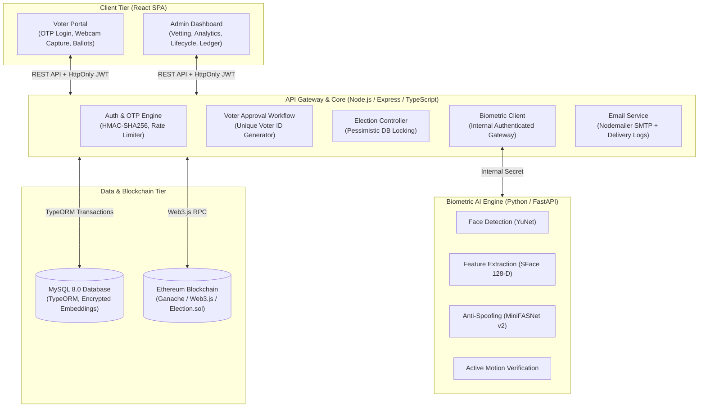
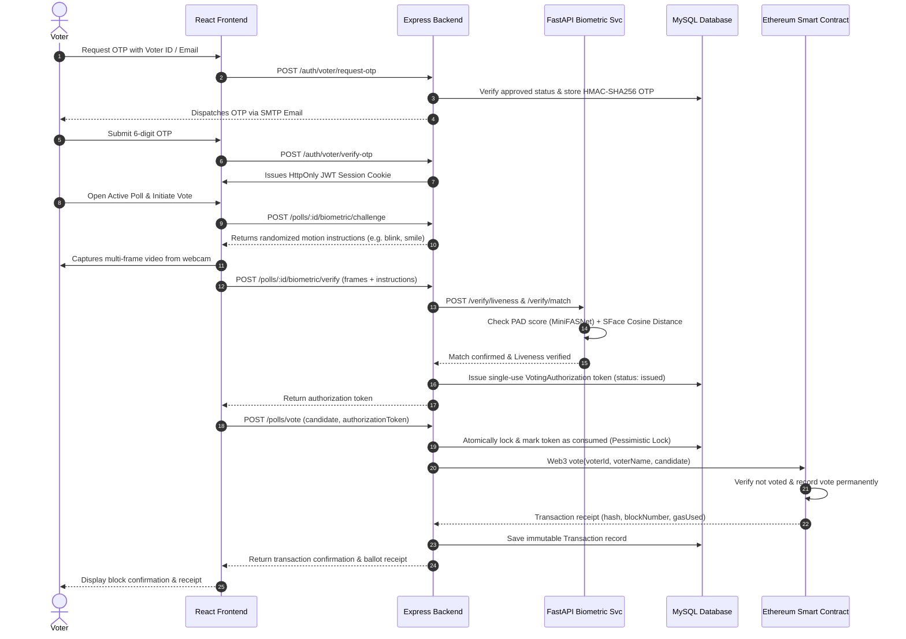

# 🗳️ Decentralized Blockchain-Based Voting System with Biometric Liveness Verification

[](https://soliditylang.org/)
[](https://ethereum.org/)
[](https://nodejs.org/)
[](https://www.typescriptlang.org/)
[](https://fastapi.tiangolo.com/)
[](https://opencv.org/)
[](https://reactjs.org/)
[](https://www.mysql.com/)

An enterprise-grade, decentralized electronic voting system engineered to eliminate voter fraud, prevent double-voting, ensure voter privacy, and provide cryptographically verifiable election audits. The platform merges **Ethereum smart contracts** for tamper-proof ballot recording with an **AI-powered biometric microservice** (featuring real-time face detection, 128-D embedding recognition, passive presentation attack detection, and active liveness challenge verification).

---

## 📺 Live Video Demonstration
> Watch the complete video walkthrough of the voting system in action:  
> **[Watch Demo on YouTube](https://www.youtube.com/watch?v=f22rJ1m7JBs&ab_channel=ROOMYAN)**  
> *(URL: `https://www.youtube.com/watch?v=f22rJ1m7JBs&ab_channel=ROOMYAN`)*

---

## 📑 Table of Contents
1. [Key Features](#-key-features)
2. [System Architecture](#-system-architecture)
3. [Voting Lifecycle Flow](#-voting-lifecycle-flow)
4. [Tech Stack](#-tech-stack)
5. [Repository Structure](#-repository-structure)
6. [Prerequisites](#-prerequisites)
7. [Step-by-Step Installation & Setup](#-step-by-step-installation--setup)
   - [1. Database Configuration (MySQL)](#1-database-configuration-mysql)
   - [2. Local Blockchain Network (Ganache)](#2-local-blockchain-network-ganache)
   - [3. Smart Contract Deployment (Truffle)](#3-smart-contract-deployment-truffle)
   - [4. Biometric Microservice Setup (FastAPI & ONNX)](#4-biometric-microservice-setup-fastapi--onnx)
   - [5. Backend API Server Setup (Node.js & Express)](#5-backend-api-server-setup-nodejs--express)
   - [6. Frontend Client Setup (React & SCSS)](#6-frontend-client-setup-react--scss)
8. [Configuration & Environment Variables](#-configuration--environment-variables)
9. [API Reference](#-api-reference)
10. [Security & Cryptography](#-security--cryptography)
11. [Testing & Quality Assurance](#-testing--quality-assurance)
12. [Disaster Recovery & Admin CLI](#-disaster-recovery--admin-cli)
13. [License & Acknowledgments](#-license--acknowledgments)

---

## 🌟 Key Features

### 1. 🛡️ Tamper-Proof Ethereum Smart Contracts
- **Decentralized Ledger**: Votes are permanently recorded on the Ethereum blockchain via Solidity smart contracts (`Election.sol`).
- **On-Chain Double-Voting Prevention**: The smart contract asserts single vote casting per registered voter identifier (`mapping(string => bool) public voterIds`).
- **Cryptographic Auditability**: Each ballot generates an immutable transaction hash, verifiable block number, and gas usage record.

### 2. 👤 AI Biometric Verification & Liveness Detection
- **Microservice Architecture**: High-performance Python FastAPI service communicating over authenticated internal channels (`X-Internal-Secret`).
- **YuNet Face Detection**: High-accuracy face detection and posture assessment (yaw, pitch, roll, blur, lighting, centering).
- **SFace Recognition Engine**: Generates 128-dimensional facial feature vectors for cosine similarity verification against enrolled voter credentials.
- **Presentation Attack Detection (PAD)**: Integrated MiniFASNet ONNX model detects 2D print attacks, cut-outs, and digital replay spoofing.
- **Active Challenge Verification**: Random multi-frame gesture challenges (e.g., eye blink, head turning, smile) to ensure real-time physical presence.
- **GDPR Compliance**: Biometric embeddings are encrypted with **AES-256-GCM** with authenticated data integrity tags and support the complete Right-to-Erasure (data deletion).

### 3. 🔐 Dual-Stage Voter Authentication & Vetting Pipeline
- **Admin Vetting Queue**: New voters submit national identification (citizenship number, full name, email). Admins review, approve, reject with feedback, or reopen applications.
- **Collision-Resistant Voter ID Generator**: Approved voters receive a unique identifier (`BBVS-YYYY-XXXXXX`) generated via cryptographically secure randomness.
- **Transactional Notifications**: Automated email notifications dispatched via Nodemailer SMTP for registration receipts, approvals, voter IDs, and rejection reasons.
- **Passwordless Two-Stage OTP Login**: Voters log in securely using their Voter ID or email with a 6-digit cryptographic HMAC-SHA256 hashed OTP, sliding-window rate limiting, and resend cooldowns.

### 4. ⚡ Atomic Concurrency & Replay Protection
- **Pessimistic Database Locking**: Single-use `VotingAuthorization` tokens are locked using `SELECT ... FOR UPDATE` transactions in MySQL, neutralizing race conditions and multi-tab double-voting attacks.
- **Dual-Layer Guard**: Enforced simultaneously at the backend authorization layer and at the Ethereum smart contract execution layer.

### 5. 📊 Administrator Command Center
- **Election Lifecycle Management**: Initialize elections, configure candidates, launch polls, terminate voting, and archive/reset cycles.
- **Real-Time Analytics**: Live voter turnout percentage, active vs. completed elections, total registered vs. verified voters.
- **Transaction Explorer**: Comprehensive ledger with filterable blockchain transaction hashes, voter IDs, candidates, block numbers, and gas consumption.
- **RFC 4180 CSV Audits**: One-click election audit export containing full ballot breakdowns and candidate totals.
- **Local Password Recovery CLI**: Secure, interactive terminal utility (`npm run admin:recover`) to restore administrator credentials without risking voter data.

---

## 🏛️ System Architecture



---

## 🔄 Voting Lifecycle Flow



---

## 💻 Tech Stack

| Domain | Technology / Library | Purpose |
| :--- | :--- | :--- |
| **Blockchain** | **Solidity `0.8.12`** | Smart contract logic (`Election.sol`) |
| | **Truffle Suite** | Contract compilation, migrations, testing |
| | **Ganache** | Local Ethereum EVM blockchain instance |
| | **Web3.js `1.7.1`** | Ethereum RPC integration and transaction submission |
| **Backend API** | **Node.js & Express 4.x** | Core REST API and routing gateway |
| | **TypeScript 5.x** | Static typing and architecture reliability |
| | **TypeORM 0.2.x** | Object-Relational Mapping and database migrations |
| | **MySQL 8.0** | Relational data persistence with ACID transactions |
| | **JWT & Cookie-Parser** | Secure session management via HttpOnly cookies |
| | **Bcrypt & Yup** | Password hashing and strict request schema validation |
| | **Nodemailer** | Transactional email delivery with delivery logging |
| **Biometric AI** | **Python 3.10+ & FastAPI** | High-throughput computer vision microservice |
| | **OpenCV (`opencv-python`)** | Image decoding, color normalization, preprocessing |
| | **ONNX Runtime** | High-performance neural network inference |
| | **YuNet Model** | Fast, accurate face detection and landmark evaluation |
| | **SFace Model** | 128-dimensional facial embedding generation |
| | **MiniFASNet v2** | Presentation attack detection (PAD / anti-spoofing) |
| **Frontend Client** | **React 17 (TypeScript)** | Single Page Application (SPA) user interface |
| | **React Router v6** | Declarative client-side routing & route guards |
| | **Axios** | HTTP client with cookie credential handling |
| | **Formik & Yup** | Form management and client-side validation |
| | **SASS / SCSS** | Modular, responsive styling system |
| **Testing** | **Jest & Supertest** | Backend integration and unit test suites |
| | **Pytest & HTTPX** | Biometric AI inference validation tests |

---

## 📂 Repository Structure

```text
Blockchain-Based-Voting-System/
├── README.md                           # Main project documentation
├── .gitignore                          # Root Git ignore rules
│
├── biometric_service/                  # Python FastAPI Biometric AI Microservice
│   ├── main.py                         # FastAPI routes & authentication
│   ├── detector.py                     # YuNet face detector & quality metrics
│   ├── recognizer.py                   # SFace 128-D embedding extractor & matcher
│   ├── anti_spoof.py                   # MiniFASNet PAD & active liveness verification
│   ├── calibration.py                  # Thresholds & camera calibration utilities
│   ├── download_models.py              # SHA256-verified ONNX model downloader
│   ├── requirements.txt                # Python dependencies
│   ├── models/                         # Downloaded ONNX model weights (git-ignored)
│   └── tests/
│       └── test_inference.py           # Pytest test suite for biometric engine
│
├── backend/                            # Node.js / Express / TypeScript API
│   ├── package.json                    # Backend dependencies & scripts
│   ├── tsconfig.json                   # TypeScript compiler options
│   ├── ormconfig.js                    # TypeORM database configuration
│   ├── truffle-config.js               # Truffle network & compiler settings
│   ├── contracts/                      # Solidity smart contracts
│   │   ├── Election.sol                # Core voting smart contract
│   │   └── Migrations.sol              # Truffle migration contract
│   ├── migrations/                     # Truffle migration deployment scripts
│   ├── scripts/
│   │   └── backup.js                   # JSON snapshot database backup utility
│   ├── src/
│   │   ├── index.ts                    # Backend entry point & DB bootstrap
│   │   ├── server.ts                   # Express server & middleware registration
│   │   ├── web3.ts                     # Web3 & Truffle contract provider
│   │   ├── controllers/
│   │   │   ├── auth/                   # Registration, login, check, voter OTP
│   │   │   ├── biometrics/             # Enrollment, verification, status
│   │   │   ├── polls/                  # Elections, votes, transactions, CSV export
│   │   │   └── users/                  # Approval workflow, voter ID assignment
│   │   ├── entity/                     # TypeORM database models
│   │   │   ├── User.ts                 # Voter & administrator accounts
│   │   │   ├── Poll.ts                 # Election metadata & status
│   │   │   ├── Candidate.ts            # Candidate profiles
│   │   │   ├── Transaction.ts          # On-chain transaction receipts
│   │   │   ├── BiometricCredential.ts  # AES-256-GCM encrypted embeddings
│   │   │   ├── BiometricChallenge.ts   # Active liveness session tracking
│   │   │   ├── VotingAuthorization.ts  # Single-use pessimistic-locked vote tokens
│   │   │   ├── OtpChallenge.ts         # HMAC-SHA256 OTP challenges
│   │   │   └── EmailDeliveryLog.ts     # SMTP notification delivery audits
│   │   ├── middlewares/                # Auth guards, cache, error handlers
│   │   ├── routers/                    # Express route definitions
│   │   ├── services/
│   │   │   ├── biometric/              # Internal BiometricClient HTTP wrapper
│   │   │   └── email/                  # Nodemailer email dispatch service
│   │   ├── scripts/
│   │   │   └── adminRecovery.ts        # CLI admin password recovery tool
│   │   ├── utils/                      # Biometric crypto, OTP hash, rate limiters
│   │   └── __tests__/                  # Comprehensive Jest test suites
│   └── build/contracts/                # Truffle compiled contract artifacts (ABIs)
│
└── frontend/                           # React 17 TypeScript Client
    ├── package.json                    # Frontend dependencies & scripts
    ├── tsconfig.json                   # TypeScript configuration
    ├── public/                         # Static assets & HTML template
    └── src/
        ├── App.tsx                     # Application root component
        ├── axios.ts                    # Global Axios client instance
        ├── components/
        │   ├── Navbar.tsx & Footer.tsx # Layout navigation & footer
        │   ├── CustomRoutes.tsx        # Dynamic role-based route manager
        │   ├── Biometrics/
        │   │   └── BiometricCaptureModal.tsx # Interactive webcam capture & liveness UI
        │   └── Polls/                  # Charts, result analytics, finished/running polls
        ├── contexts/
        │   └── Auth.tsx                # React authentication context & session state
        ├── layouts/                    # Default, login, user, and admin layouts
        ├── pages/
        │   ├── Home.tsx                # Public landing page
        │   ├── Login.tsx               # Voter passwordless OTP login
        │   ├── AdminLogin.tsx          # Administrator credential login
        │   ├── Signup.tsx              # Voter self-registration portal
        │   ├── View.tsx                # Public poll results viewer
        │   ├── Admin/                  # Admin portal (Dashboard, Elections, Users, TXs)
        │   └── User/                   # Voter portal (Polls, History, Profile)
        └── styles/                     # SCSS styles, mixins, and theme variables
```

---

## 📋 Prerequisites

Ensure the following tools are installed on your workstation:
- **Node.js**: `v16.x` or `v18.x` (LTS recommended)
- **npm**: `v8.x` or `v9.x`
- **Python**: `3.10` or higher
- **MySQL Server**: `8.0+`
- **Ganache**: [Ganache UI](https://trufflesuite.com/ganache/) or `ganache-cli`
- **Truffle Suite**: Install globally via `npm install -g truffle`
- **Git**
- **Webcam**: Required for biometric enrollment and liveness challenge verification

---

## 🚀 Step-by-Step Installation & Setup

### 1. Database Configuration (MySQL)
Create a dedicated MySQL database for the voting system:
```sql
CREATE DATABASE bbvs CHARACTER SET utf8mb4 COLLATE utf8mb4_unicode_ci;
CREATE USER 'bbvs'@'localhost' IDENTIFIED BY 'your_database_password';
GRANT ALL PRIVILEGES ON bbvs.* TO 'bbvs'@'localhost';
FLUSH PRIVILEGES;
```

---

### 2. Local Blockchain Network (Ganache)
Launch Ganache to spin up a local Ethereum network:
- **RPC Server**: `HTTP://127.0.0.1:7545`
- **Network ID**: `5777`
- Ensure at least 10 accounts with 100 ETH each are available.

---

### 3. Smart Contract Deployment (Truffle)
Navigate to the `backend` folder, install dependencies, and deploy contracts to Ganache:
```bash
cd backend
npm install
npx truffle compile
npx truffle migrate --reset --network development
```
*This compiles `Election.sol` and writes the ABI and contract address to `backend/build/contracts/Election.json`.*

---

### 4. Biometric Microservice Setup (FastAPI & ONNX)
In a new terminal, set up the Python biometric service:
```bash
cd biometric_service

# Create virtual environment
python -m venv venv

# Activate virtual environment
# Windows (PowerShell):
.\venv\Scripts\Activate.ps1
# Linux / macOS:
# source venv/bin/activate

# Install requirements
pip install -r requirements.txt

# Download verified ONNX model weights (YuNet, SFace, MiniFASNet)
python download_models.py

# Launch the FastAPI service on port 8001
uvicorn main:app --host 127.0.0.1 --port 8001 --reload
```
You can verify the microservice is operational by visiting `http://127.0.0.1:8001/health`.

---

### 5. Backend API Server Setup (Node.js & Express)
In the `backend` folder, configure your environment variables:
```bash
cd backend
cp .env.example .env
```
Edit `.env` with your MySQL credentials, JWT secrets, and SMTP settings (see [Environment Variables](#-configuration--environment-variables)).

Run database migrations:
```bash
npm run typeorm migration:run
```

*(Optional) Create or reset an administrator account securely using the recovery utility:*
```bash
npm run admin:recover
```

Start the backend server on port `8000`:
```bash
npm start
```

---

### 6. Frontend Client Setup (React & SCSS)
In another terminal, initialize and run the React frontend:
```bash
cd frontend
npm install
npm start
```
The React application will open automatically at `http://localhost:3000`.

---

## ⚙️ Configuration & Environment Variables

### Backend Environment Configuration (`backend/.env`)
Create a `.env` file inside `backend/`:

| Variable | Required | Default | Description |
| :--- | :---: | :--- | :--- |
| `NODE_ENV` | No | `development` | Runtime environment (`development`, `test`, `production`) |
| `PORT` | No | `8000` | Backend API HTTP server port |
| `FRONTEND_URL` | No | `http://localhost:3000` | Allowed CORS origin for the React client |
| `DB_HOST` | Yes | `localhost` | MySQL host address |
| `DB_PORT` | No | `3306` | MySQL port |
| `DB_USERNAME` | Yes | `bbvs` | MySQL user |
| `DB_PASSWORD` | Yes | - | MySQL user password |
| `DB_DATABASE` | Yes | `bbvs` | MySQL database name |
| `RPC_URL` | No | `http://127.0.0.1:7545` | Ethereum JSON-RPC provider (Ganache) |
| `ACCESS_TOKEN_SECRET` | Yes | - | High-entropy secret (min 64 chars) for JWT access token signing |
| `REFRESH_TOKEN_SECRET` | Yes | - | High-entropy secret (min 64 chars) for JWT refresh token signing |
| `OTP_HASH_SECRET` | Yes | - | High-entropy HMAC secret (min 64 chars) for one-time password hashing |
| `BIOMETRIC_SERVICE_URL` | No | `http://127.0.0.1:8001` | URL for the Python Biometric Microservice |
| `BIOMETRIC_SERVICE_SECRET` | No | `b10m3tr1c_s3rv1c3_...` | Shared internal authentication secret |
| `BIOMETRIC_ENCRYPTION_KEY` | No | - | Key used for AES-256-GCM encryption of biometric embeddings |
| `SMTP_HOST` | Yes | `smtp.gmail.com` | SMTP host for outgoing notification emails |
| `SMTP_PORT` | No | `587` | SMTP port (587 for TLS, 465 for SSL) |
| `SMTP_SECURE` | No | `false` | True for SSL (port 465), false for STARTTLS |
| `SMTP_USER` | Yes | - | SMTP email account username |
| `SMTP_PASS` | Yes | - | SMTP app password |
| `EMAIL_FROM` | No | `BBVS <no-reply@bbvs.local>` | "From" address for dispatched emails |

### Biometric Service Configuration (`biometric_service/.env` or system env)
| Variable | Required | Default | Description |
| :--- | :---: | :--- | :--- |
| `BIOMETRIC_SERVICE_SECRET` | No | `b10m3tr1c_s3rv1c3_s3cr3t_2026_d3v` | Must match backend secret for inter-service authentication |

---

## 📡 API Reference

### 1. Authentication & Voter Onboarding (`/auth`)
| Method | Endpoint | Access | Description |
| :--- | :--- | :--- | :--- |
| `POST` | `/auth/signup` | Public | Submit registration application (sets status to `PENDING_APPROVAL`) |
| `POST` | `/auth/voter/request-otp` | Public | Request a 6-digit email OTP using Voter ID or registered email |
| `POST` | `/auth/voter/verify-otp` | Public | Verify OTP and obtain authenticated JWT session cookies |
| `POST` | `/auth/voter/resend-otp` | Public | Resend active OTP (enforces rate-limiting and cooldown) |
| `POST` | `/auth/login` | Public | Administrator credential login (email + password) |
| `POST` | `/auth/check` | Authenticated | Validate existing JWT session and retrieve active user profile |
| `POST` | `/auth/logout` | Authenticated | Clears authentication cookies and invalidates session |

### 2. Biometric Operations (`/auth/biometrics`)
| Method | Endpoint | Access | Description |
| :--- | :--- | :--- | :--- |
| `POST` | `/auth/biometrics/enrollment/challenge` | Authenticated | Request active liveness challenge gestures for enrollment |
| `POST` | `/auth/biometrics/enrollment/verify` | Authenticated | Validate liveness, extract 128-D embedding, encrypt, and enroll |
| `GET` | `/auth/biometrics/status` | Authenticated | Query voter biometric enrollment state and model version |
| `DELETE` | `/auth/biometrics` | Authenticated | GDPR Right-to-Erasure: permanently remove voter biometric profile |

### 3. Elections & Voting (`/polls`)
| Method | Endpoint | Access | Description |
| :--- | :--- | :--- | :--- |
| `GET` | `/polls` | Public | Retrieve active or specific election details and candidates |
| `GET` | `/polls/status` | Public | Query current blockchain election status (`not-started`, `running`, `finished`) |
| `POST` | `/polls/check-voteability` | Public / Auth | Check if voter is eligible and has not yet voted |
| `POST` | `/polls/:id/biometric/challenge` | Authenticated | Request randomized biometric voting verification challenge |
| `POST` | `/polls/:id/biometric/verify` | Authenticated | Verify liveness & match embedding; issue single-use `VotingAuthorization` |
| `POST` | `/polls/vote` | Verified Voter | Atomically consume authorization token and record vote on-chain |
| `GET` | `/polls/voter/history` | Authenticated | Retrieve authenticated voter's historical ballot transaction receipts |
| `POST` | `/polls/start` | Admin Only | Initialize and activate a new election with candidates |
| `POST` | `/polls/end` | Admin Only | Terminate the active election |
| `POST` | `/polls/reset` | Admin Only | Reset smart contract election state for a new cycle |
| `GET` | `/polls/admin/stats` | Admin Only | Fetch real-time participation metrics and voter statistics |
| `GET` | `/polls/admin/transactions` | Admin Only | Inspect all on-chain transactions with search and filter options |
| `GET` | `/polls/export-csv` | Admin Only | Export RFC 4180-compliant election audit CSV |

### 4. Voter Vetting & User Management (`/users`)
| Method | Endpoint | Access | Description |
| :--- | :--- | :--- | :--- |
| `GET` | `/users/pending-registrations` | Admin Only | List all voter registrations filtered by approval status |
| `POST` | `/users/approve-registration` | Admin Only | Approve application, generate unique Voter ID, and dispatch email |
| `POST` | `/users/reject-registration` | Admin Only | Reject registration with specified reason and send notification email |
| `POST` | `/users/reopen-registration` | Admin Only | Reopen a rejected registration for re-evaluation |
| `POST` | `/users/resend-voter-id-email` | Admin Only | Resend official Voter ID credential email to voter |
| `DELETE` | `/users/delete/:id` | Admin Only | Deactivate or delete user account |

---

## 🔒 Security & Cryptography

```text
┌────────────────────────────────────────────────────────────────────────┐
│                        SECURITY ARCHITECTURE                           │
├────────────────────────────────┬───────────────────────────────────────┤
│ Biometric Embedding Protection │ AES-256-GCM authenticated encryption  │
│                                │ with random 12-byte IV & 16-byte tag  │
├────────────────────────────────┼───────────────────────────────────────┤
│ One-Time Password (OTP)        │ HMAC-SHA256 hashed with secret key;   │
│                                │ Constant-time timingSafeEqual compare │
├────────────────────────────────┼───────────────────────────────────────┤
│ Anti-Spoofing & Liveness       │ MiniFASNet v2 PAD + Multi-frame       │
│                                │ active motion verification challenges │
├────────────────────────────────┼───────────────────────────────────────┤
│ Double-Voting Prevention       │ On-chain mapping (voterIds[id] = true)│
│                                │ + MySQL pessimistic transaction locks │
├────────────────────────────────┼───────────────────────────────────────┤
│ Session Management             │ HttpOnly, SameSite, Secure JWT        │
│                                │ Access & Refresh token rotation       │
├────────────────────────────────┼───────────────────────────────────────┤
│ Service Authentication         │ Shared secret validation via          │
│                                │ X-Internal-Secret HTTP header         │
├────────────────────────────────┼───────────────────────────────────────┤
│ DoS & Brute Force Prevention   │ Memory-backed sliding-window rate     │
│                                │ limiter on OTP requests and attempts  │
└────────────────────────────────┴───────────────────────────────────────┘
```

---

## 🧪 Testing & Quality Assurance

### Backend Test Suite (Jest & Supertest)
The backend includes automated integration tests covering authentication, voter registration workflows, election management, and biometric validation:
```bash
cd backend
npm test
```
To run a specific test suite:
```bash
npx jest src/__tests__/auth.test.ts
npx jest src/__tests__/registration_approval.test.ts
npx jest src/__tests__/biometrics.test.ts
npx jest src/__tests__/election_management.test.ts
```

### Biometric Microservice Tests (Pytest)
Validate model initialization, inference, authentication, and cosine matching:
```bash
cd biometric_service
pytest tests/test_inference.py -v
```

---

## 🛠️ Disaster Recovery & Admin CLI

### Administrator Password Recovery
If administrator credentials are lost or need to be reset in an emergency, use the included CLI recovery utility:
```bash
cd backend
npm run admin:recover
```
Or specify the target email via environment variables:
```bash
ADMIN_EMAIL="admin@bbvs.local" NEW_ADMIN_PASSWORD="StrongNewPassword123!" npm run admin:recover
```
**Features of the recovery tool:**
- Safely updates password hash using `bcrypt` (10 rounds).
- Performs post-hash verification (`bcrypt.compare`) before writing to the database.
- Preserves all voter accounts, biometric credentials, and blockchain transactions intact.

### Database Snapshot Backup
Create an instant JSON snapshot backup of all tables:
```bash
cd backend
node scripts/backup.js
```
The snapshot is saved to `backend/backup_bbvs_<timestamp>.json`.

---

## 📄 License & Acknowledgments

- **Smart Contracts & Application Code**: Licensed under the MIT License.
- **Biometric Deep Learning Models**:
  - **YuNet Face Detector**: Licensed under [Apache-2.0](https://github.com/opencv/opencv_zoo/tree/main/models/face_detection_yunet) by OpenCV.
  - **SFace Face Recognizer**: Licensed under [Apache-2.0](https://github.com/opencv/opencv_zoo/tree/main/models/face_recognition_sface) by OpenCV & Beijing University of Posts and Telecommunications.
  - **MiniFASNet v2 Anti-Spoofing**: Licensed under [Apache-2.0](https://github.com/minivision-ai/Silent-Face-Anti-Spoofing) by Minivision.
